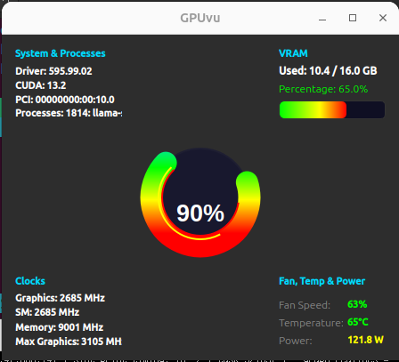
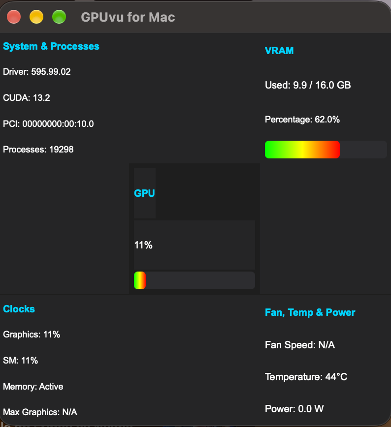

# GPUvu

A real-time GPU monitoring application for Linux (NVIDIA) and macOS (Apple Silicon) built with Python and PyQt6.




## Features

- **Real-time GPU Metrics** - 1-second refresh rate
- **Visual GPU usage indicator**
- **VRAM Monitoring** - Real-time memory usage with progress bar
- **Clock Speeds** - GPU, SM, and memory clock monitoring
- **Temperature & Power** - Thermal and power consumption tracking
- **Dark Theme** - Clean, modern dark interface (#1e1e1e)

### Linux Version


**Features:**
- NVIDIA GPU monitoring with `nvidia-smi`
- CUDA utilization, temperature, and power usage
- Fan speeds and compute status
- Dark theme with real-time updates

### macOS Version


**Features:**
- Apple Silicon GPU monitoring with `apple-smi`
- Metal GPU utilization and temperature
- Power consumption tracking
- No fan speeds (Apple Silicon has no fans)

## Installation

### Linux (NVIDIA)

```
Download the binary using the torrent file gpuvu.torrent

# Make binary executable
$>chmod +x gpuvu

# Run it or double click the icon
$>./gpuvu

```

### macOS (Apple Silicon)

```bash
Download the binary using the torrent file MacGPUvu.torrent

# Make binary executable
$>chmod +x MacGPUvu

# Run it or double click the icon
$>./MacGPUvu

```

## Architecture

### Backend
- **Linux**: `NVIDIAGPUManager` using `nvidia-smi`
- **macOS**: `MacGPUManager` using `apple-smi`

### Frontend
- PyQt6 with dark theme (#1e1e1e background, #252526 panels)
- 3x3 grid layout (400x400 window)
- Custom widgets for each metric

## License

MIT License - See LICENSE file for details

## Credits

- Built with PyQt6
- macOS backend: [apple-smi](https://github.com/AppleSMI/apple-smi)
- Linux backend: nvidia-smi

## Contributing
